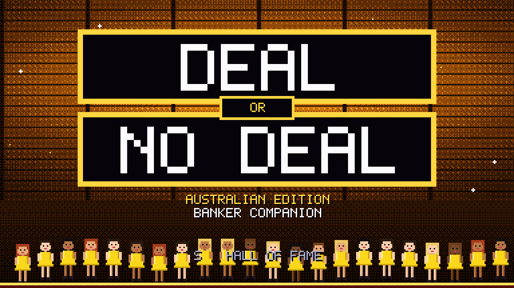
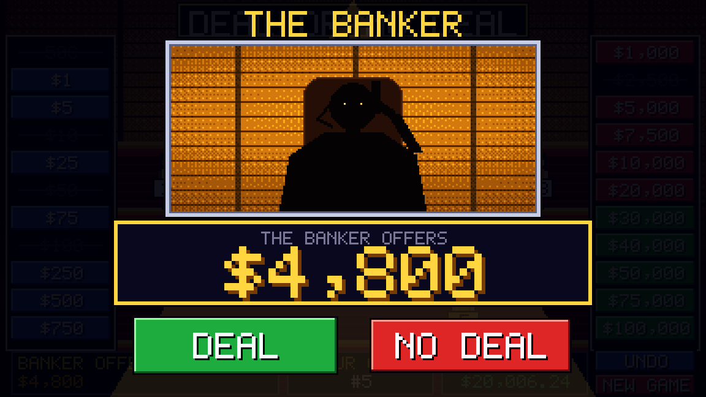

# Deal or No Deal - Banker Companion

A Pygame "banker" for playing *Deal or No Deal* as a real-life board game. Play with physical briefcases or cards at the
table and let the app run the show: it tracks which values are still in play, rings the phone, makes the Banker's
offer and keeps a Hall of Fame. Set up for the Australian edition (22 cases, Australian dollar values).

| Title screen | The Banker's offer |
|---|---|
|  |  |

## How it works

1. Pick your own case, then record each case as it is opened at the table by choosing its value from the board.
2. After each round the phone rings and the Banker makes an offer based on the values still in play.
3. Press **Deal** to take it or **No Deal** to carry on. The final result and your score go to the Hall of Fame.

Everything is drawn in a retro pixel style with animated cases, banker calls and sound effects. Mute with `M`.

## Install and run

Requires Python 3.9+ (and a display).

```bash
pip install -r requirements.txt
python deal_or_no_deal_v4.py
```

## Keys

U undo, N new game, S Hall of Fame, M mute, F11 fullscreen, Esc quit.

Scores are stored in `deal_or_no_deal_scores.json` next to the script (override with `DND_SCORES`).

## Running checks locally

```
python -m pip install -r requirements-dev.txt
ruff check .
python -m pytest        # headless; sets SDL dummy drivers itself
```
(Windows PowerShell: use `py -m` instead of `python -m`.) CI runs exactly these on Ubuntu and Windows.

## Making a release

1. Move items from `[Unreleased]` in `CHANGELOG.md` into a new `## [X.Y.Z] - date` section.
2. Set `__version__ = "X.Y.Z"` in `deal_or_no_deal_v4.py` (the single source of truth). Versioning is SemVer.
3. Open a PR; merge once CI is green.
4. Tag the merge commit and push the tag:
   ```
   git checkout main && git pull
   git tag -a vX.Y.Z -m "vX.Y.Z" && git push origin vX.Y.Z
   ```
5. The **Release** workflow verifies the tag matches `__version__`, re-runs lint and tests, then creates the
   GitHub Release with notes from the changelog, the game file, `requirements.txt`, a source zip and `SHA256SUMS.txt`.
